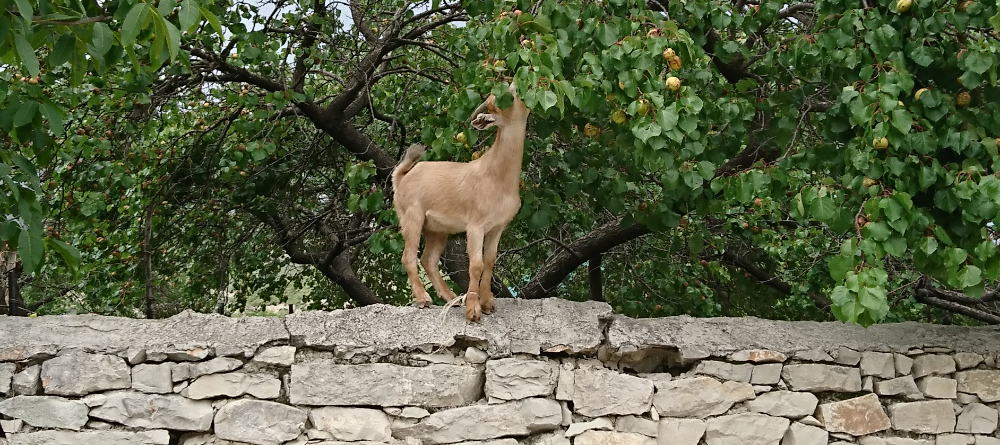

```{r setup, include=FALSE}
knitr::opts_chunk$set(echo = TRUE)
```

![*Mountain views from the Caucasus drawn by J.A. Güldenstädt (1787-1791)*.[^3]](images/berg.png)

[^3]: J.A. Güldenstädt's *Reisen durch Russland und im Caucasischen Gebürge* is available online at Russia's [State Public Historical Library](http://elib.shpl.ru/ru/nodes/26689-guldenstadt-j-a-reisen-durch-russland-und-im-caucasischen-geburge-st-petersburg-1787-1791), accessed on 10.01.2020. 

<br>

This website provides an overview of my research as a linguist specializing in East Caucasian languages, evidentiality and areal typology. It was created with `RMarkdown` in RStudio [@rstudio].

<br>

## About me

My given name is Samira, but my first name on my passport is Jannigje Helena. This has to do with a silly Dutch custom of giving children multiple Christian names as their official first name, and then calling them something else in daily life. (Read more about this [here](https://dutchreview.com/featured/what-is-a-roepnaam-explained/).) Names for daily use will often be derived from a first name, or at least start with the same letter, but not always.

Contrary to a persistent myth, Samira is not my Caucasiologist pseudonym, but one of the names given to me by my parents. I always go by this name unless I am forced to do otherwise. So please call me Samira and consider Jannigje Helena my tax-form filling alter ego.

Most of my academic career as a linguist has been based in Russia, until I quit my job at HSE University, Moscow in March 2022. When Russia invaded Ukraine in February 2022, I no longer felt safe in Russia, as a foreigner who did not support the invasion. So I left in early March and quit my job a week later, when I found out that the head of the university where I worked signed a letter in support of the invasion.

After leaving Russia I decided to switch careers and started working as a data engineer. I continue some of my linguistic work as an independent researcher in my free time and hope to combine the two disciplines at some point -- documenting language and digitally archiving the material in such a way that it will be durably preserved and becomes more accessible to anyone who might be interested.

<br>

## Current projects

### Botlikh documentation
Botlikh is a small, unwritten language of the East Caucasian language family (Andic branch). I started working on this language by chance in 2017, when I was asked to edit and supplement a draft grammar sketch by the renowned Caucasiologist Mikhail Alexeyev. At some point this text will appear as a chapter in a new handbook on Caucasian languages. For now a recent draft version is available [here](https://github.com/sverhees/site/blob/master/papers/botlikhgrammar_draft.pdf).

In 2019 I teamed up with Chiara Naccarato to investigate Botlikh's unique agreement system (see our talks on this topic: [1](https://github.com/sverhees/2019sle_ordinals), [2](https://github.com/sverhees/2019_Animacy-origin), [3](https://github.com/sverhees/2021mt_negcop/blob/master/2021mt_negative_copulas.pdf) and a general overview [handout](https://github.com/sverhees/site/blob/master/other/Animacy_in_Botlikh.pdf)). We are also in the process of translating and annotating Botlikh texts recorded by our predecessors, and plan to add new material to the corpus. Some texts from the collection are published [here](https://sverhees.github.io/botlikh_khabar/). Aigul Zakirova recorded some new material in 2021, and Sara Zadykian and Polina Artemeva recorded new texts in 2022. The latter were swiftly turned into a corpus which is available [here](https://lingconlab.ru/botlikh/).

Some general background on the language and our work (along with some alluring pictures) is given in [these slides](https://github.com/sverhees/2019_labseminar_botlikh/blob/master/201910_labseminar_Botlikh(slides).pdf). Note that the slides are from 2019 and therefore not entirely up-to-date.

I used to manage an [Instagram](https://www.instagram.com/botlikh_rasha/) account about the Botlikh language. It is still up, but I do not post regularly anymore. A telegram account with the same name is also available, but not regularly updated either.

<br>

## Past projects

### Database of Arabic, Persian and Turkic loans in Daghestanian languages
The aim of the DAG<APT project was to create a single searchable database from the rich literature on lexical borrowing from Arabic, Persian and Turkic into various Daghestanian languages. This could then be used simply for reference, but also to get an overview of the spread and adaptation of borrowings from these languages in Daghestan. 

Arabic, Persian and Turkic are prolific borrowing sources for Daghestanian languages due to their cultural importance. Arabic is the language of religion, and Persian and Turkic were important languages for trade and exchange of knowledge. Of course these languages have also influenced each other, so a borrowing of an Arabic lexeme into a Daghestanian language may have been mediated through Persian and/or a local Turkic language like Azerbaijani.

A comprehensive database of such borrowings can help identify different historical and regional layers of borrowing processes, and perhaps identify cases of mediated borrowing in a more reliable and systematic way.

The database is available [here](https://lingconlab.github.io/DAG-APT/).
As mentioned on the page, I took the first step in setting up the database (inspired by Timur Maisak), but Timofei Dedov and Timofei Balahanov turned it into an actual resource, and George Moroz wrote the necessary script to extract data from the available literature.


### Andi documentation (Zilo dialect)
The Andi language is a neighbor of Botlikh. I am one of several people who have worked on various aspects of Andi grammar by studying the dialect of the village Zilo since 2016. A grammar sketch is <span style="color: #CC0066;">in preparation</span>.

### Variation in unwritten languages
Variation among speakers is a known problem for any linguist doing fieldwork, whether their purpose is language documentation or investigation of a theoretical problem.

During fieldwork in the village Zilo in 2019, George Moroz conducted an experiment to measure the variation rate of several features known to be variable in the local dialect of Andi. We then sent out a survey to researchers of East Caucasian languages about their preferences and habits for conducting fieldwork, to estimate the probability that an average researcher would catch the rate of variation measured. Some results are discussed [here](https://github.com/agricolamz/2019.11.26_ConLab_Zilo_variation) and [here](https://github.com/agricolamz/2020.04.24_RSUH_Zilo_variation).

### Typological Atlas of Daghestan
The project [Typological Atlas of Daghestan (TALD)](http://lingconlab.ru/dagatlas/) is a tool to visualize information about linguistic structures characteristic of Dagestan. The Atlas consists of datasets with information about particular features. Each year, several students of the School of Linguistics at HSE University Moscow (as well as interns from other universities) collect new datasets for the Atlas as part of a workshop. I used to coordinate this workshop together with Chiara Naccarato, and was involved in designing the structure and workflow of the Atlas. [Click here](https://lingconlab.github.io/TALD_manual/) if you are interested in becoming a contributor of the Atlas.

### Evidentiality as part of tense-aspect in East Caucasian languages
My PhD project dealt with the grammaticalization and areal distribution of evidentiality as part of the tense-aspect system in East Caucasian languages. An overview of my findings is in [this paper](https://escholarship.org/uc/item/1zf7z1ck). You can find more information about my dissertation in the [dedicated repository](https://sverhees.github.io/dissertation_evidentiality/home.html).

### Loanwords in Dagestan
The [Daghestanian Loans](https://ilcl.hse.ru/en/projects) project investigates how patterns of multilingualism in Dagestan are reflected in lexical borrowings at the village level. I worked on this project with Michael Daniel, Ilya Chechuro and Nina Dobrushina from 2017--2019, collecting and annotating lexical data. The results are a [database](https://lingconlab.github.io/Dagloan_database/DL_database.html), several talks and posters, and two papers.

<br>



<br>
<a rel="me" href="https://toot.community/@smrms"></a>
<a rel="me" href="https://mastodon.nl/@smrms"></a>

## References
